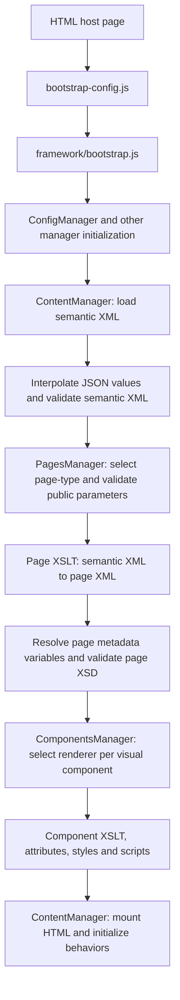

# Rendering pipeline

## Separation of contracts

| Layer | Example | Owner |
| --- | --- | --- |
| Semantic document | `s:content`, `s:section`, `s:paragraph` | `ContentManager`, semantic XSDs |
| Intermediate page document | `p:course-page` → `p:meta` + `p:layout` | `PagesManager`, selected page XSD and XSLT |
| Visual component fragments | `p:navbar`, `p:hero`, `p:section` | `ComponentsManager`, component manifests/XSDs |
| Rendered HTML | `.ck-navbar`, `.ck-hero` etc. | Individual renderers and XSLTs |

`p:course-page` is a document envelope; `p:layout` is a visual component. The shared page base XSD declares metadata and abstract `p:page`, but does not depend on a particular visual component. `course-page.xsd` extends that base to require `p:layout`.

The `learning` module registers an independently selectable `learning-page` built from `course-page` plus an overlay. Selecting `course-page` alone does **not** apply that overlay.
